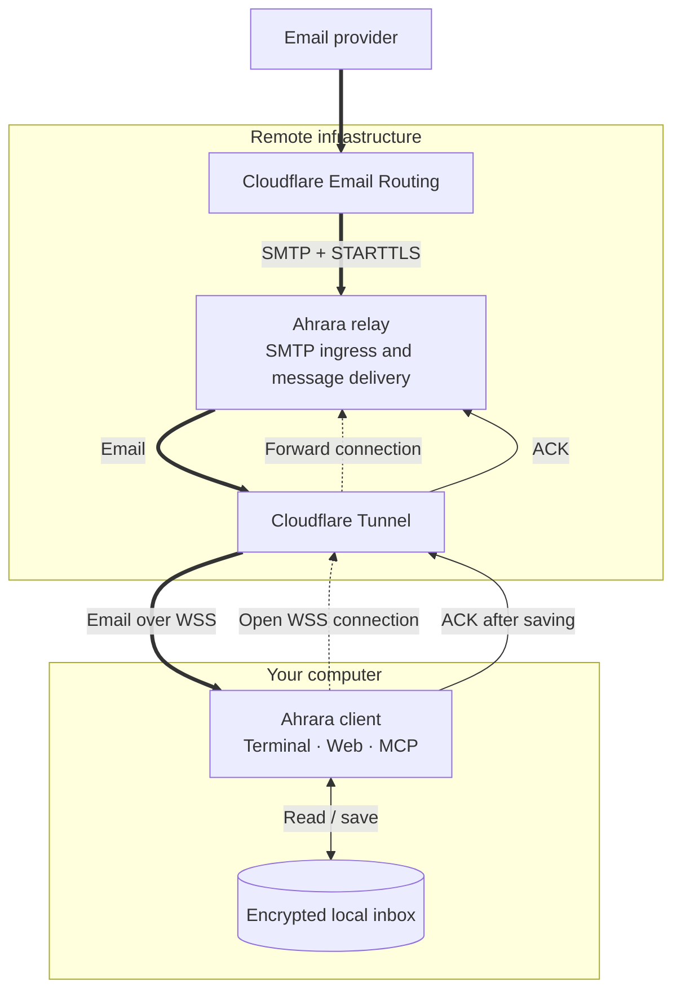

<p align="center">
  
</p>

<h1 align="center">Ahrara</h1>

<p align="center">Zero Retention. Fast. Simple. Free.</p>

Ahrara lets you create unique email addresses and receive messages in an inbox
on your own computer. Read mail in the terminal or browser, or let an AI agent
work with your inbox through MCP.

**Ahrara receives email; it does not send it.** Zero Retention applies to the
relay. Received messages stay on your computer until you delete them.

## 📦 Install

Install Ahrara on Linux, macOS, or Windows, on x64 or ARM64.

<details>
<summary>🍺 Homebrew — macOS and Linux</summary>

With Homebrew installed:

```sh
brew tap hitmasu/ahrara https://github.com/Hitmasu/Ahrara.git
brew install hitmasu/ahrara/ahrara
```

Run `ahrara --version` to confirm the installation.

</details>

<details>
<summary><code>&gt;_</code> Shell — macOS and Linux</summary>

Requires `curl` and a POSIX shell:

```sh
curl -fsSL https://ahrara.dev/install.sh | sh
```

Apply any PATH instructions printed by the installer, then open a new terminal
and run `ahrara --version`.

</details>

<details>
<summary>💻 PowerShell — Windows</summary>

Run in PowerShell:

```powershell
iwr https://ahrara.dev/install.ps1 -useb | iex
```

Open a new PowerShell window and run `ahrara --version`.

</details>

<details>
<summary>⬇️ Manual download — All platforms</summary>

Choose the executable for your operating system and architecture:

| Platform | x64 | ARM64 |
| --- | --- | --- |
| Linux | [Download](https://github.com/Hitmasu/Ahrara/releases/latest/download/ahrara-linux-x86_64) | [Download](https://github.com/Hitmasu/Ahrara/releases/latest/download/ahrara-linux-aarch64) |
| macOS | [Download](https://github.com/Hitmasu/Ahrara/releases/latest/download/ahrara-darwin-x86_64) | [Download](https://github.com/Hitmasu/Ahrara/releases/latest/download/ahrara-darwin-aarch64) |
| Windows | [Download](https://github.com/Hitmasu/Ahrara/releases/latest/download/ahrara-windows-x86_64.exe) | [Download](https://github.com/Hitmasu/Ahrara/releases/latest/download/ahrara-windows-aarch64.exe) |

On **Linux or macOS**, rename the download to `ahrara` and run these commands
from its directory:

```sh
chmod +x ahrara
sudo mkdir -p /usr/local/bin
sudo mv ahrara /usr/local/bin/ahrara
```

If `/usr/local/bin` is not on your `PATH`, add
`export PATH="/usr/local/bin:$PATH"` to your shell's startup file and reopen
the terminal.

On **Windows**, rename the download to `ahrara.exe` and move it to a permanent
folder, such as `C:\Ahrara`. Open **Edit environment variables for your account →
Path → Edit → New**, add that folder, and reopen PowerShell.

Run `ahrara --version` to confirm the installation.

</details>

## 🚀 Quick start

```sh
ahrara
```

1. Wait for **Connected**. Your first address is created automatically and shown
   in the **Email** row; press **C** to copy it.
2. Send a message to that address using your usual email provider.
3. Select the received message with **↑/↓** and press **Enter** to read it.

**Keep Ahrara running and connected to receive messages.** Press **Ctrl+C** to
stop. Ahrara does not queue messages for disconnected clients; already received
mail remains in your local inbox.

Press **/** to manage addresses and interfaces. See the [user guide](docs/usage.md)
for the full command and configuration reference.

## 🌐 Web interface

The Web interface starts with `ahrara` by default. Open the URL shown in
the terminal's **Web** row, or select **/ → Web Page → Open Web Page**.

Search and read messages, view HTML, download EML and attachments, and create,
disable, or delete addresses.

Access is limited to your own computer by default, with no password required.
Use **/ → Web Page** to set a password or disable the interface. See the
[Web guide](docs/usage.md#web) for session settings, HTML privacy controls, and
LAN access.

## 🤖 MCP

MCP lets an AI agent manage addresses, wait for incoming mail, read messages,
and save attachments. Install the [Ahrara plugin](docs/agents.md) to let the
agent install and start Ahrara itself. The plugin is distributed through this
repository for Claude Code, Codex, Copilot CLI, Gemini CLI, and other agents.

For an already running Ahrara, MCP is enabled by default; use **/ → MCP**
to copy its URL or disable it. Local connections use HTTP without authentication
by default.

**Claude Code.** Add the following to `.mcp.json` in your project directory.
If you changed the local address, use the complete MCP URL shown in the terminal.

```json
{
  "mcpServers": {
    "ahrara": {
      "type": "http",
      "url": "http://127.0.0.1:8787/mcp"
    }
  }
}
```

Keep Ahrara running, launch `claude` from that project in another terminal, and
approve the MCP server when prompted. No certificate or token setup is needed.

Enable HTTPS with `--https` and bearer authentication with `--mcp-auth`, separately
or together. See [MCP options](docs/usage.md#https-and-authentication) for setup,
and the [MCP guide](docs/usage.md#mcp) for non-interactive use, profiles, attachment
destinations, and shared receiver controls.

## 🏗️ Architecture



1. **Receive.** Cloudflare Email Routing forwards mail to the relay's SMTP
   receiver using STARTTLS, independently of the Tunnel.
2. **Deliver.** The client opens an authenticated WSS connection through
   Cloudflare Tunnel. The relay streams incoming mail over that connection.
3. **Save and confirm.** The client saves mail in the encrypted inbox shared by
   Terminal, Web, and MCP, then sends an ACK. Only then does the relay confirm
   SMTP delivery.

See the [server documentation](server/README.md) for deployment details.

## 🔐 Security

**Identity.** Ahrara creates an Ed25519 Identity locally to authenticate with the
relay. Your Recovery Key restores that Identity and derives the inbox encryption
key. Keep it private; restoring messages also requires an
[encrypted inbox backup](docs/usage.md#backups).

**Transport.** SMTP ingress requires STARTTLS. WSS and a pinned Noise session
protect relay-to-client traffic. Senders, forwarding providers, and the relay
can read messages; Ahrara does not provide sender-to-recipient end-to-end
encryption.

**Local access.** Web and MCP use HTTP on loopback without authentication by
default. HTTPS, a Web password, and MCP bearer authentication are optional; the
API always requires its token. LAN access requires HTTPS and an MCP token.
The Web password does not encrypt Identity or token files. See
[access options](docs/usage.md#https-and-authentication) and
[Web sessions and LAN access](docs/usage.md#web).

**Storage and retention.** SQLCipher encrypts messages, attachments, and addresses
locally. Exported EML, attachments saved outside the inbox, and runtime memory are
not covered. Local data has no automatic expiry; deleting an address preserves
its messages, which you can delete separately. The relay keeps delivery state in
memory without a persistent inbox, but emits operational logs. Zero Retention
does not mean zero logging.

Treat email as untrusted input, including when passing it to an AI agent.
See [SECURITY.md](SECURITY.md) for security boundaries and vulnerability reporting.

## 🤝 Contributing

See [CONTRIBUTING.md](CONTRIBUTING.md#build-and-run) for development requirements
and build commands. Before submitting changes, run:

```sh
make check
make test
```

Use the [checks guide](CONTRIBUTING.md#checks) for API and integration checks,
and the [release guide](docs/releasing.md) when preparing a release.

Report reproducible bugs through [issues](https://github.com/Hitmasu/Ahrara/issues)
and propose focused changes through pull requests. Keep code and documentation
in English.

## 📄 License

[MIT](LICENSE). Vendored dependencies and icons retain their licenses:
[client](cli/third_party/README.md), [server](server/third_party/README.md),
and [icons](site/assets/icons/README.md).
