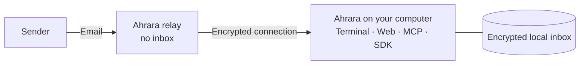

<p align="center">
  
</p>

<h1 align="center">Ahrara</h1>

<p align="center"><em>Zero Retention. Simple. Free. Open Source.</em></p>

<p align="center"><strong>Disposable email built for AI agents, QA and automation.</strong></p>

<p align="center">
  <a href="https://ahrara.dev/">Website</a> ·
  <a href="https://ahrara.dev/docs/">Documentation</a> ·
  <a href="https://ahrara.dev/docs/pt-br/">Português</a> ·
  <a href="https://ahrara.dev/docs/es/">Español</a> ·
  <a href="https://github.com/sponsors/Hitmasu">Sponsor</a>
</p>

Ahrara gives you disposable email addresses with an inbox on your own computer.
Receive any email, then read it in the terminal or browser, hand it to your AI
agent through MCP, or assert on it from your test suite.

- **Zero Retention.** The relay streams mail to your computer and keeps no inbox.
  Received mail stays in your encrypted local inbox until you delete it.
- **Built for automation.** Plugins for 25 coding agents, an MCP server, a local
  HTTP API and SDKs for TypeScript, Python, .NET, Java, Go, Rust and k6.
- **Receive-only.** Ahrara never sends email or relays it to other servers.
- **Free and open source** under the MIT License.

## 📦 Install

macOS and Linux:

```sh
curl -fsSL https://ahrara.dev/install.sh | sh
```

Windows (PowerShell):

```powershell
iwr https://ahrara.dev/install.ps1 -useb | iex
```

Or with npm, on any of them:

```sh
npm install -g ahrara
```

Or with Homebrew:

```sh
brew tap hitmasu/ahrara https://github.com/Hitmasu/Ahrara.git
brew install hitmasu/ahrara/ahrara
```

Every method installs one executable for Linux, macOS or Windows on x64 or ARM64;
they are also on [GitHub Releases](https://github.com/Hitmasu/Ahrara/releases/latest)
([manual install](https://ahrara.dev/docs/#install-manual)). Run `ahrara --version`
to confirm the installation.

## 🚀 Quick start

```sh
ahrara
```

1. Wait for **Connected**. Your first address is created automatically and shown
   in the **Email** row; press **C** to copy it.
2. Send a message to that address, or sign up with it in the app you are testing.
3. Select the received message with **↑/↓** and press **Enter** to read it.

Keep Ahrara running to receive email: mail is not queued while you are offline.
Press **/** for address, Web and MCP commands, and **Ctrl+C** to stop. The
[user guide](docs/usage.md) covers every command and setting.

## 🤖 AI agents

Install the plugin and your agent installs and starts Ahrara itself. Through MCP
it can create addresses, wait for verification codes, read messages and check
email templates.

| Agent | Install |
| --- | --- |
| Claude Code | `/plugin marketplace add Hitmasu/Ahrara`, then `/plugin install ahrara@ahrara` |
| Codex | `codex plugin marketplace add Hitmasu/Ahrara`, then `codex plugin add ahrara@ahrara` |
| GitHub Copilot CLI | `copilot plugin marketplace add Hitmasu/Ahrara`, then `copilot plugin install ahrara@ahrara` |
| Gemini CLI | `gemini extensions install https://github.com/Hitmasu/Ahrara` |

Plugins need Node.js 20+. Cursor, Windsurf, Cline, OpenCode, Kiro and 16 other
agents are supported through plugins, rules or instructions; see the
[agents guide](docs/agents.md). Any other MCP host can run Ahrara over stdio:

```json
{
  "mcpServers": {
    "ahrara": {
      "command": "ahrara",
      "args": ["mcp", "--transport", "stdio"]
    }
  }
}
```

To connect over HTTP instead, see the [MCP guide](docs/usage.md#mcp).

## 🧩 SDKs

Give each test its own inbox. SDKs connect directly to the relay, so no CLI needs
to run alongside your tests.

| Language | Install |
| --- | --- |
| TypeScript / JavaScript | `npm install @ahrara/sdk` |
| Python | `pip install ahrara` |
| .NET | `dotnet add package Ahrara` |
| Java | Maven dependency `io.github.hitmasu:ahrara` |
| Go | `go get github.com/Hitmasu/Ahrara/src/sdks/go@latest` |
| Rust | From source, see the [Rust guide](src/core/README.md) |
| k6 | Custom k6 build, see the [k6 guide](src/sdks/k6/README.md) |

```ts
import { Ahrara } from '@ahrara/sdk';

const inbox = await Ahrara.createInbox();
try {
  // Use inbox.address in the signup form of the app under test.
  const match = await inbox.waitForRegexMatch('[0-9]{6}', {
    timeoutMs: 30_000,
    filter: { subject: 'Verification' },
  });
  console.log(match.value); // The verification code.
} finally {
  await inbox.close();
}
```

The SDKs work with Playwright, Cypress, Robot Framework, Selenium, pytest, xUnit
and JUnit. The [SDK guide](docs/sdks.md) covers filters, links, attachments and
keeping an inbox between runs.

## 🌐 Web interface

The Web interface starts with `ahrara`. Open the URL in the terminal's **Web**
row to search and read messages, view HTML, download EML and attachments, and
manage addresses. See the [Web guide](docs/usage.md#web) for passwords and LAN
access.

To use it without installing anything, open [app.ahrara.dev](https://app.ahrara.dev):
the same interface connects to the relay from your browser and keeps your inbox
there. Keep a tab open to receive email; the
[browser app guide](docs/usage.md#browser-app) explains how to move an Identity
between the browser and the CLI.

## 🏗️ How it works



1. A sender delivers mail to your Ahrara address.
2. The relay streams it to your connected client over an encrypted connection
   and keeps no copy.
3. Your client saves it to the encrypted inbox and confirms; only then does the
   relay accept the delivery from the sender.

See [how delivery works](https://ahrara.dev/docs/#delivery) and the
[server documentation](src/server/README.md) to run your own relay.

## 🔐 Security

- Your Identity is created on your computer. The Recovery Key restores it and
  unlocks your inbox, so keep it private.
- Mail is encrypted on its way to your client and in your local inbox.
- Ahrara is not end-to-end encrypted: senders, forwarding providers and the
  relay can read messages.
- Web, MCP and the API listen only on your computer by default, and MCP and the
  API require a token. The browser app keeps its Identity and inbox in that
  browser's storage.
- Treat email as untrusted input, especially when an AI agent reads it.

See [SECURITY.md](SECURITY.md) for security boundaries and how to report a
vulnerability.

## 💖 Support

Ahrara is free to use. If it saves you time, consider
[sponsoring the project on GitHub](https://github.com/sponsors/Hitmasu) to help
keep it online and evolving.

## 🤝 Contributing

See [CONTRIBUTING.md](CONTRIBUTING.md) for the development setup, checks and pull
requests, and the [release guide](docs/releasing.md) for publishing a release.
Report reproducible bugs through [issues](https://github.com/Hitmasu/Ahrara/issues).

## 🙏 Acknowledgments

The relay's integrated Cloudflare Tunnel connector is derived from
[libcfd](https://github.com/apersomany/libcfd) by apersomany. Thank you for
building a programmable Tunnel client in Rust; Ahrara's connector starts from
it under the Apache-2.0 license, as recorded in the
[server notice](src/server/NOTICE).

## 📄 License

[MIT](LICENSE). Vendored dependencies, derived code, and icons retain their
licenses: [shared dependencies](src/third_party/README.md),
[server](src/server/NOTICE), and [icons](src/site/assets/icons/README.md).
